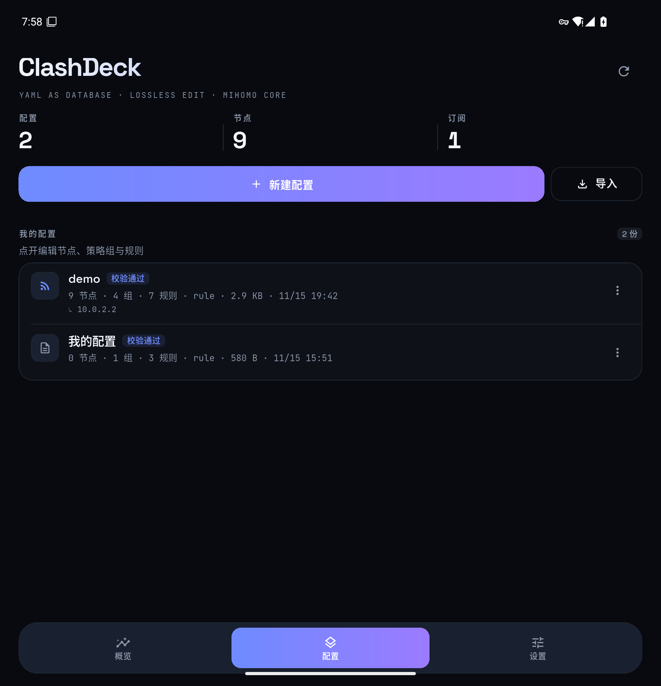
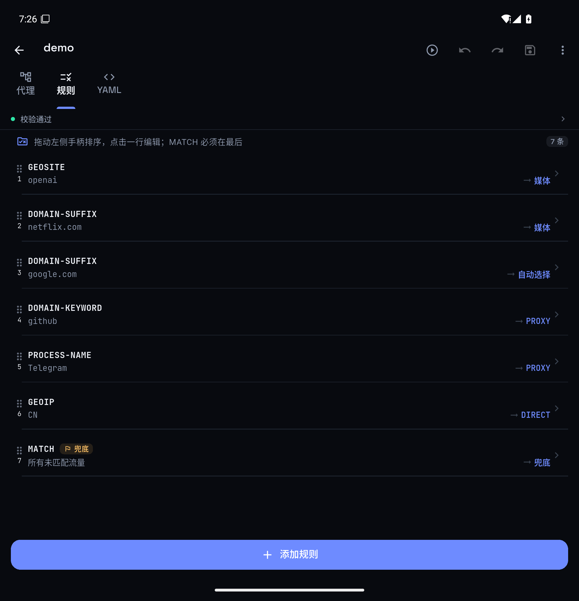
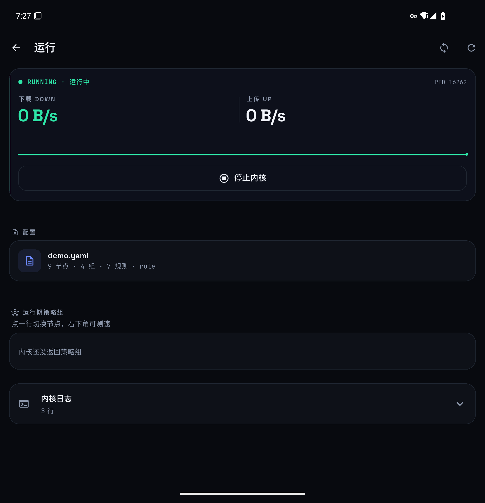
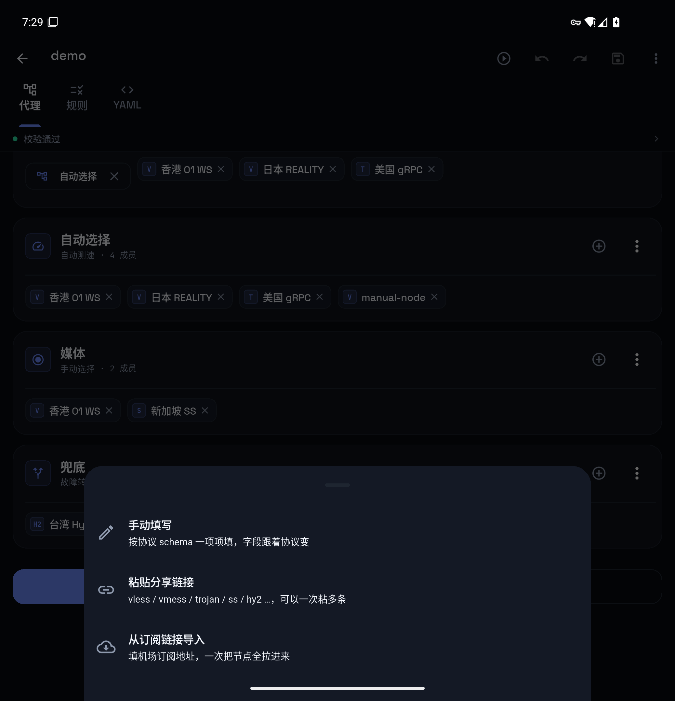
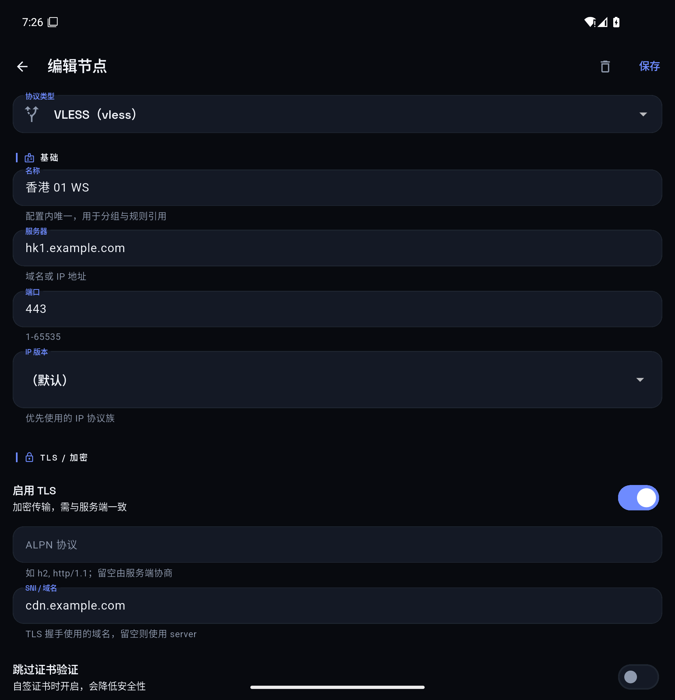

# ClashDeck

**Android 上的 mihomo（Clash.Meta）图形客户端：把 YAML 当数据库来编辑。**

Clash 系客户端大多只让你旁路改 YAML 文本——加一个 vless 节点、把节点挪进某个策略组、
调一下规则顺序，都得开编辑器手写，还要记住内核那一堆字段名。ClashDeck 做的是把这件事
变成点按：

- **可视化加节点**：13 种协议的字段表内建，表单按协议动态生成，TLS / 传输层
  （ws / grpc / h2 / http / reality / ech）分组折叠
- **跨组拖拽**：长按节点芯片拖到别的策略组；拖到顶部「节点列表」= 从当前组移除。
  节点列表默认折叠，展开后能看到全部节点（不管在不在组里）
- **规则可视化**：拖动排序、点选改目标、`no-resolve` 勾选、`MATCH` 兜底检查，
  还能整段导入别人给的规则片段（规则 + 策略组 + provider 一起合并）
- **导入一条龙**：`vless://` `vmess://` `ss://` `trojan://` … 分享链接、base64 订阅、
  整份 YAML，一个输入框全接；可以导入到已有配置，并直接选进哪个策略组
- **订阅链接**：填机场订阅地址就能一次把节点拉进来（明文 / base64 / 整份 YAML 都认，
  顺带读流量信息），地址会记住，下次打开预填、可以再拉一次（同名节点跳过）
- **无损编辑**：所有改动都在原文件上做局部替换，注释、空行、键顺序与内核私有字段全部保留
- **内置内核**：随包带 mihomo，点一下就用 VpnService 启 TUN；跑着改配置会热重载不掉线

## 下载安装

预编译安装包在 Releases：**https://github.com/yurin7/ClashDeck/releases/latest**

| 文件 | ABI | 适用 |
| --- | --- | --- |
| `ClashDeck-0.1.0-arm64-v8a.apk` | arm64-v8a | 绝大多数手机（33.1 MB，推荐） |
| `ClashDeck-0.1.0-x86_64.apk` | x86_64 | 模拟器 / x86 平板（35.2 MB） |

- `minSdk 24`（Android 7.0+），`targetSdk 36`；APK 内已带内核与 GEOIP/GEOSITE 数据，装完即用
- 当前用 **debug keystore 签名**（自用/测试足够，不用于上架）；没有 armeabi-v7a 包
- 首次「启动内核」会请求 VPN 授权；不想接管全局流量，可在设置里切「仅代理端口」

包名 `dev.clashdeck`，许可证 **GPL-3.0**（与 mihomo 一致）。完整条款见 [LICENSE](LICENSE)；
随包分发的 mihomo 二进制、GEOIP/GEOSITE 数据与所做的构建补丁见 [NOTICE.md](NOTICE.md)。

## 快速上手

1. 「配置」页点「导入」：贴一份 YAML、几条分享链接，或一个订阅地址；也可以「新建配置」
   从模板开始
2. 进配置 →「代理」Tab：点「添加节点」（手填 / 粘链接 / 订阅三选一），芯片长按可拖到别的组
3. 「规则」Tab：拖动手柄排序、点一行编辑；「导入规则」可以吞整段 Clash 片段
4. 「YAML」Tab：随时核对原文，注释与键顺序都在
5. 「概览」页点「启动内核」：TUN 接管流量；设置页里能开分应用代理、DNS、分流模式、
   订阅自动更新等（见下表）

## 界面

图是在 x86_64 模拟器（Android 16）上真实截的，配置为 demo（4 个组、9 个节点、7 条规则）。

| | |
| --- | --- |
|  |  |
| 概览：状态英雄卡（速率 / 迷你折线 / PID）+ 代理模式与分流模式分段开关 + 当前配置 + 内核日志 | 配置：三项统计 + 行式配置列表，每行显示节点/组/规则数与校验状态 |
|  |  |
| 设置：运行 / 分流 / DNS / 订阅 / 导入 / 其它六个分区 | 代理板：组面板 + 节点芯片，长按跨组拖拽；组套组显示为策略组芯片 |
|  |  |
| 规则：等宽类型 + 序号 + `payload → 目标`，拖动排序，MATCH 带旗标 | YAML：等宽字体，注释/空行/键顺序原样保留，可直接整段编辑 |
|  |  |
| 运行页：状态 + 大号速率 + 策略组当前选择，点一行即可切节点 | 添加节点：手填 / 粘链接 / 订阅三路入口 |
|  |  |
| 订阅：拉取后显示节点数与标题，地址记在配置旁边，下次预填 | 节点表单：按协议 schema 渲染，只显示这个协议真的有的字段 |

## 设置里能开哪些开关

属于内核配置的项写进 YAML（无损改，注释与键序不动），属于客户端行为的项写进
`<配置>.yaml.meta.json` 的 `app` 段——这样把 YAML 交给别的客户端用也不会多出未知键。

| 分区 | 开关 | 落到哪里 |
| --- | --- | --- |
| 运行 | 代理模式：TUN 模式 / 仅代理端口 | meta `app.proxyMode`；决定起不起 VPN 与 TUN |
| 运行 | 分应用代理：全部应用 / 仅选中的 / 排除选中的 + 选择应用 | meta `app.routeMode` + `app.routePackages` |
| 运行 | TUN 协议栈：gvisor / system / mixed（默认 gvisor） | YAML `tun.stack` |
| 运行 | TUN MTU：1500 / 4064 / 9000 | YAML `tun.mtu` |
| 分流 | 模式：规则 / 全局 / 直连 | YAML `mode` |
| 分流 | 允许局域网 | YAML `allow-lan`（开启后同 Wi-Fi 可用本机 7890） |
| 分流 | IPv6 | YAML `ipv6` |
| 分流 | 日志级别：silent…debug | YAML `log-level` |
| DNS | 启用、fake-ip / redir-host、fake-ip 范围、名称服务器 | YAML `dns.*` |
| 订阅 | 订阅地址、自动更新周期（关/6/12/24/72 小时）、上次更新、立即更新 | meta `subscriptionUrl` + prefs `lastSubscriptionUpdate` |
| 导入 | 粘贴 YAML / 链接 / 订阅地址 | 写盘并打开编辑器 |
| 其它 | 开机自启、内核版本与许可 | meta `app.launchOnBoot` |

TUN 默认使用 `gvisor` 协议栈，这也是推荐设置。`system` / `mixed` 虽然能选，但在手机上
一般只能解析 DNS、网页依旧打不开（它们需要系统级转发权限），换成这两个大概率是「连上了却
没网」，遇到这种情况切回 `gvisor` 即可。

## 支持的协议

vless / vmess / trojan / shadowsocks / shadowsocksr / socks5 / http(s) / hysteria2 /
tuic / wireguard / snell / ssh / anytls，含 reality、ws、grpc、h2、ech 等传输层选项。

## 开发

```powershell
cd E:\project\Agents\ClashAndroid
flutter test              # 单测（Windows 上直接跑，不用设备）
flutter analyze
flutter build apk --debug # 产物 build\app\outputs\flutter-apk\app-debug.apk
```

只打 64 位包（体积从 ~130 MB 降到 ~99 MB）：

```powershell
flutter clean   # 换 ABI 组合必须先 clean，否则会留旧 ABI 的残余 .so
flutter build apk --debug --target-platform android-arm64,android-x64
```

### 内核二进制不在仓库里

`android/app/src/main/jniLibs/{arm64-v8a,x86_64}/libmihomo.so` 是预编译的 mihomo 内核，
两个加起来 118 MB、单文件也超过 GitHub 的 100 MB 上限，所以没有入库。**克隆后直接构建能
通过，但运行时内核启动会提示找不到文件**，先补一步：

```powershell
git clone --depth 1 -b Alpha https://github.com/MetaCubeX/mihomo D:\dev\_downloads\mihomo-src\mihomo-Alpha
.\tool\build_core.ps1        # 复制源码 → 打构建约束补丁 → 交叉编译两个 ABI
```

产物会直接写进 `jniLibs/<abi>/libmihomo.so`。armeabi-v7a 没有内核，32 位设备上无法启动。

## 发布

打 tag 就会自动发版（不需要本地打包）：

```powershell
git tag -a v0.1.1 -m "ClashDeck v0.1.1"
git push origin v0.1.1
```

GitHub Actions 会：

1. 在 runner 上用 `tool/build_core.sh` 现编 mihomo 内核（arm64-v8a / x86_64，含 anet 构建约束补丁）；
2. `flutter analyze` + `flutter test`；
3. `flutter build apk --release --split-per-abi`，只产出有内核的两个 ABI；
4. 把 `ClashDeck-<版本>-<abi>.apk` 挂到该 tag 的 Release 上，并生成变更说明。

流水线页面：<https://github.com/yurin7/ClashDeck/actions>

## 目录

```
lib/core/     纯 Dart：yaml / model / edit / schema / parse / validate（无 Flutter 依赖，可单测）
lib/data/     配置与偏好落盘（tmp+rename 原子写）
lib/state/    编辑器状态、设置状态
lib/ui/       概览 / 配置 / 设置三页 + 编辑页（代理·规则·YAML）+ 动态表单
lib/runtime/  mihomo REST 客户端、运行配置生成、子进程控制器、GEOIP/GEOSITE 落盘
android/app/src/main/kotlin/dev/clashdeck/   VpnService、内核进程、MethodChannel 桥
assets/geo/   随包携带的 GEOIP/GEOSITE 数据，首启铺到内核工作目录
```

架构与内核启动细节见 [docs/ARCHITECTURE.md](docs/ARCHITECTURE.md)。
