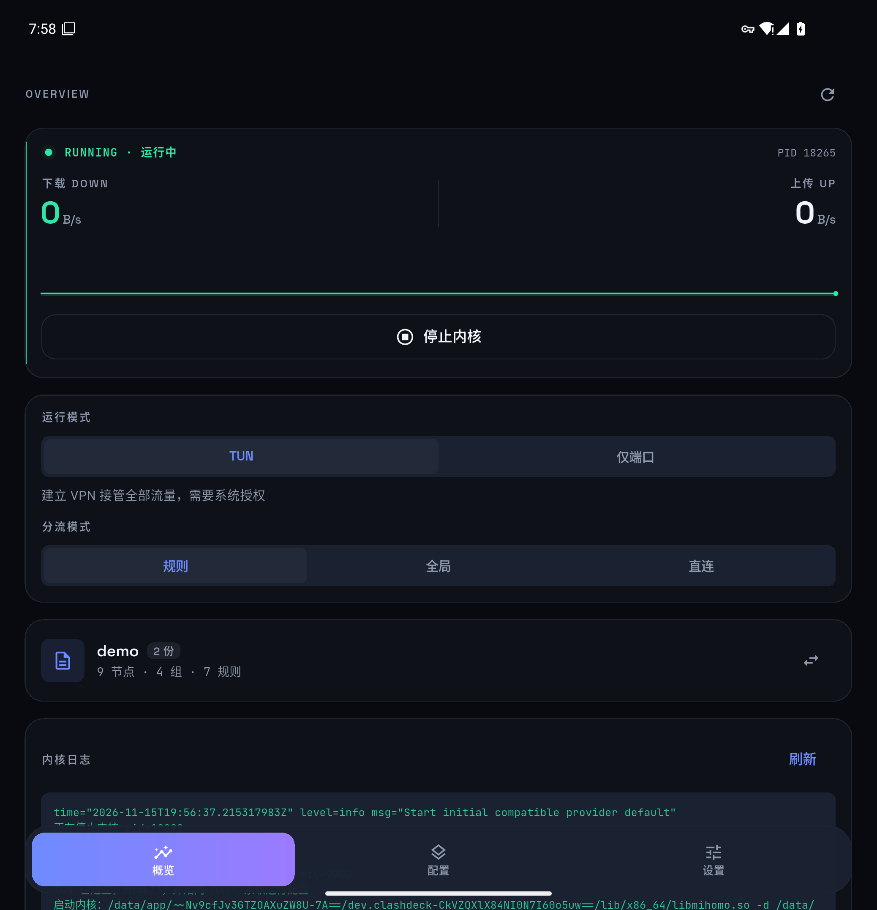
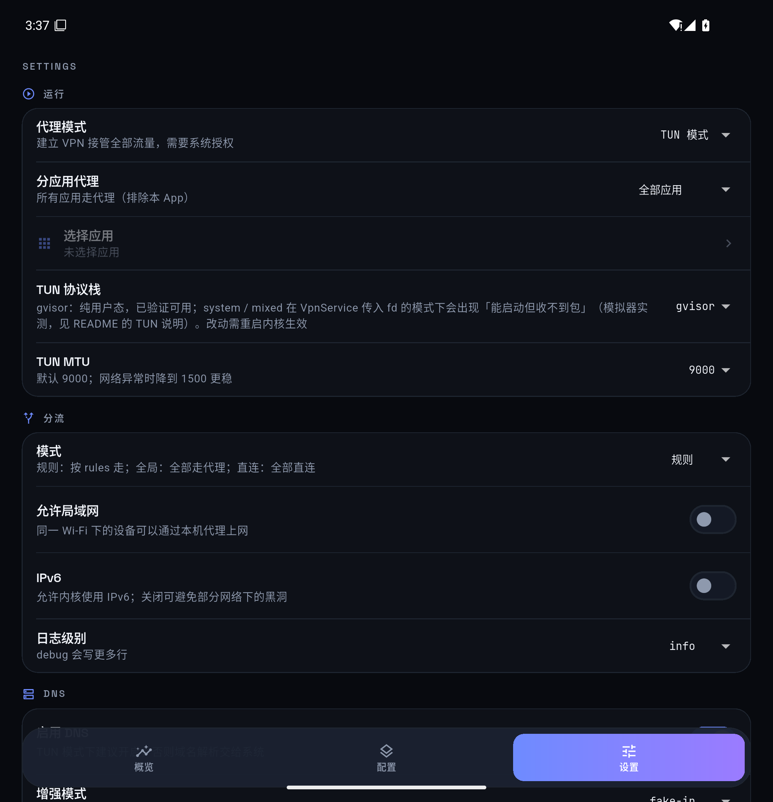
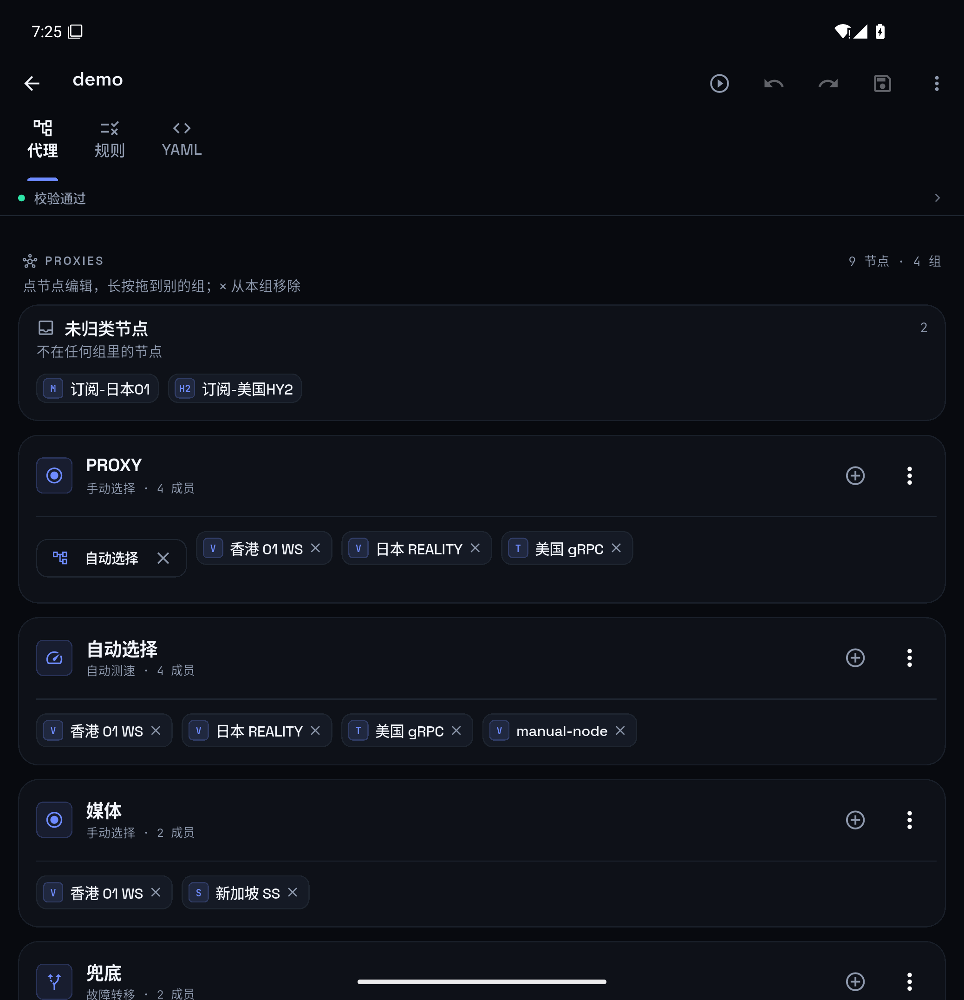
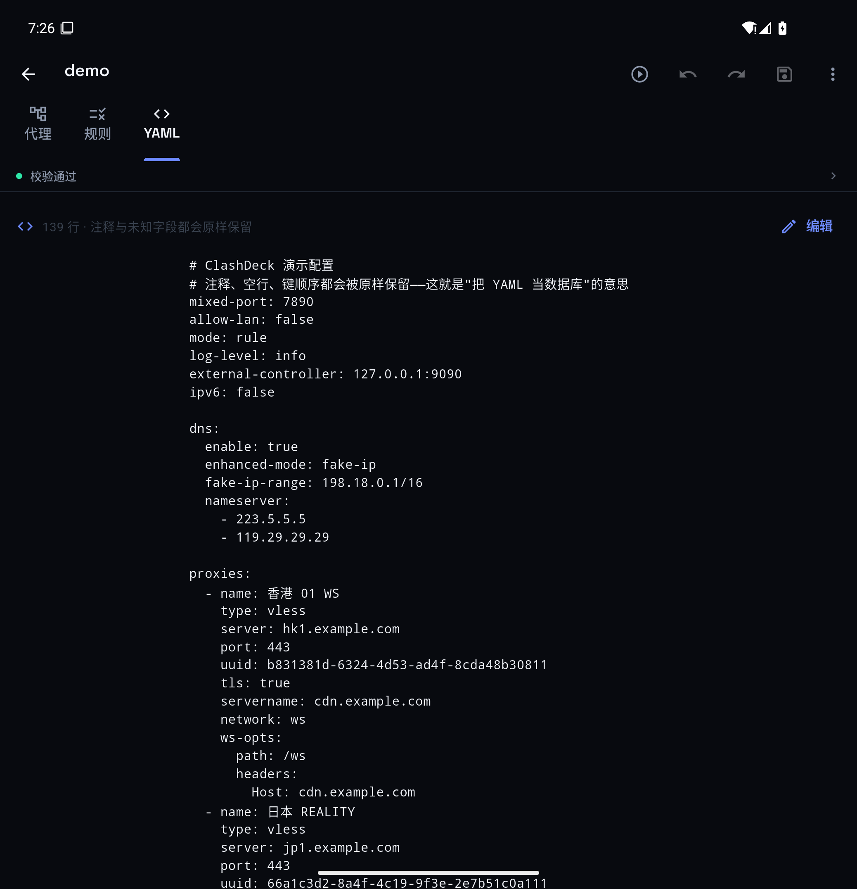
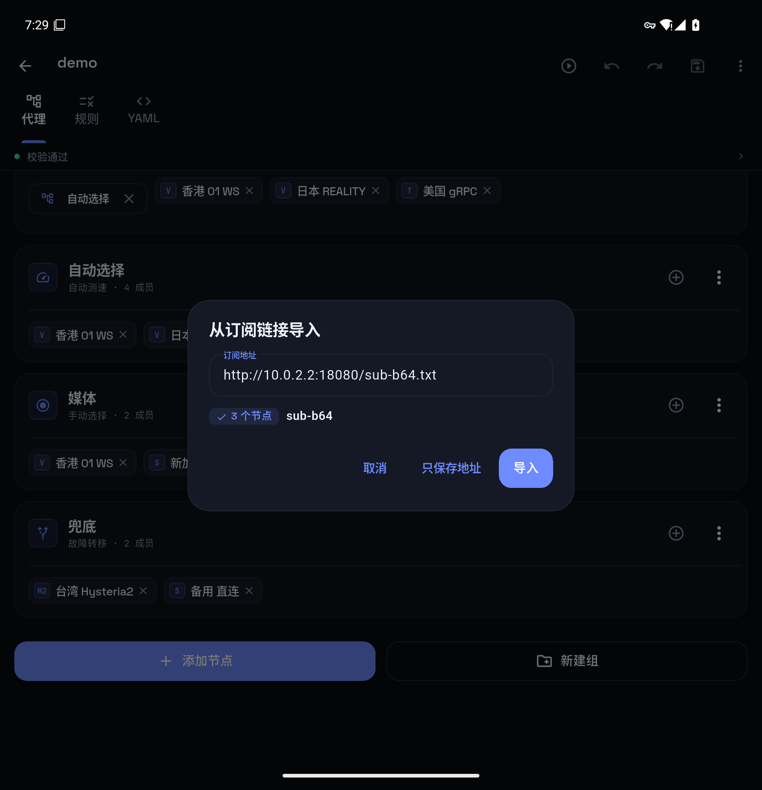

# ClashDeck

**面向 Android 的 mihomo（Clash.Meta）图形客户端 —— 直接把 YAML 当数据库来编辑。**

Clash 系客户端大多只让你旁路改 YAML 文本：想加一个 vless 节点、把节点挪进某个策略组、
调一下规则顺序，都得开编辑器手写，还得记住内核那一堆字段名。ClashDeck 想做的是：

- **可视化加节点**：13 种协议（vless / vmess / trojan / ss / ssr / socks5 / http / hysteria2 /
  tuic / wireguard / snell / ssh / anytls）的字段表内建，表单按协议动态生成，TLS / 传输层
  （ws / grpc / h2 / http / reality / ech）分组折叠；
- **跨组拖拽**：长按节点芯片拖到别的策略组；拖到顶部「节点列表」= 从当前组移除。顶部「节点列表」默认折叠，展开后能看到**全部**节点（不管在不在组里）；
- **规则可视化**：拖动排序、点选改目标、`no-resolve` 勾选、`MATCH` 兜底检查；
- **粘贴即导入**：`vless://` `vmess://` `ss://` `trojan://` … 分享链接、整段 base64 订阅、
  或者一份完整 YAML，一种输入框全接；**导入可以落到已有配置里**（不是只能新建），
  解析完直接选进哪个策略组；
- **订阅链接**：填机场订阅 URL 就能一次把节点全拉进来（明文 / base64 / 整份 YAML 三种
  订阅体都认，顺手读 `subscription-userinfo` 显示流量），地址会记在配置旁边
  `<名字>.yaml.meta.json` 里，下次打开自动填好、可以再拉一次（同名节点跳过，不覆盖你改过的）；
- **无损**：所有编辑都在原始源码上做局部替换，**注释、空行、键顺序、内核私有字段全部保留**。
  改完一个标量就只变那一行（有测试断言）。
- **内置内核**：打包 mihomo（linux/arm64 静态二进制），点一下就用 VpnService 起 TUN，
  运行页能看状态、速率、日志，跑着改配置会热重载而不掉线。

## 下载安装

预编译安装包在 Releases 里：**https://github.com/yurin7/ClashDeck/releases/latest**

| 文件 | ABI | 适用 |
| --- | --- | --- |
| `ClashDeck-0.1.0-arm64-v8a.apk` | arm64-v8a | 绝大多数手机（33.1 MB，推荐） |
| `ClashDeck-0.1.0-x86_64.apk` | x86_64 | 模拟器 / x86 平板（35.2 MB） |

- `minSdk 24`（Android 7.0+），`targetSdk 36`；APK 里已带 mihomo 内核与 GEOIP/GEOSITE 数据，装完即用
- 当前用 **debug keystore 签名**（自用/测试足够，不用于上架）；没有 armeabi-v7a 包
- 安装后首次「启动内核」会请求 VPN 授权；不想接管全局流量可以在设置里切「仅代理端口」模式

工作名 ClashDeck，包名 `dev.clashdeck`，许可证 **GPL-3.0**（与 mihomo 一致）。
完整条款见 [LICENSE](LICENSE)；随包分发的 mihomo 二进制、GEOIP/GEOSITE 数据与所做的
构建补丁都在 [NOTICE.md](NOTICE.md) 里交代清楚了。

## 现在到哪一步了

| 模块 | 状态 |
| --- | --- |
| YAML 无损编辑 / 模型 / 30 类体检 / 10 种链接解析 / 链接与订阅导入 | ✅ 239 个单测全绿 |
| 三页 IA：底部悬浮岛切换「概览 / 配置 / 设置」，一个 `AppShell` 持有唯一内核控制器 | ✅ |
| 配置列表、导入、分组拖拽、节点动态表单、规则编辑、YAML 视图 | ✅ |
| mihomo 子进程 + VpnService 传 fd + 运行页 | ✅ 模拟器（Android 16 / x86_64）跑通：TUN 监听 `tun0(fd=158)`、REST 在线、测速 87–148 ms；待真机复验 |
| 代理设置开关化（TUN/仅端口、分应用代理、TUN MTU、DNS、分流模式、局域网、IPv6、订阅自动更新、日志级别） | ✅ 逐项写进 YAML 或 sidecar 并验证生效 |

关于 TUN：**支持**，而且是默认模式——`VpnService.Builder` 建 TUN、`detachFd()` 后把 fd 交给
mihomo（`tun.file-descriptor`），内核在子进程里从 TUN 收包。协议栈固定 **gVisor**：system /
mixed 需要内核自建网卡并给网卡套地址，实测在「系统给的 fd」上会
`bind: cannot assign requested address`，所以设置页只留 gVisor 并写明了原因；MTU 仍然可调
（实测改成 1500 后 `ip addr show tun0` 与内核日志都跟着变）。
| 应用图标 / 启动页 | ⬜ 仍是 Flutter 默认 logo |

模拟器上验证过的完整链路（`adb logcat -s ClashDeck.Core`）：

```
[TUN] Tun adapter listening at: tun0(fd=158)([198.18.0.1/30],[]), mtu: 9000, ip stack: gVisor
RESTful API listening at: 127.0.0.1:9090
Load MMDB file: /data/user/0/dev.clashdeck/files/mihomo/geoip.metadb
[TCP] 172.19.0.1:54618 --> storage.googleapis.com:443 match Match using PROXY[DIRECT]
```

两处不踩过的坑已写进架构文档：`ProcessBuilder` 在 Android 上会关掉所有继承 fd（改自己
fork/exec，见 §5）；`GOOS=linux` 会漏掉 mihomo 的 android netlink 修复（改构建约束，见 §5.2）。

编辑器在模拟器上逐条走通的交互（`adb shell run-as dev.clashdeck cat files/profiles/*.yaml` 对账）：

- 「添加节点」按协议渲染 schema 表单 → 保存 → 选择加入哪个组；写出的 YAML 键序是人读的顺序
  （`name / type / server / port / uuid …`），注释与顶层顺序原样保留；
- 组内芯片的删除图标 = 从组移除（节点仍在「节点列表」里），组卡片「添加成员」再拉回来；组里已经包含全部节点和策略组时再点 ⊕ 会给提示；
- 「添加规则」插到 `MATCH` **之前**（追加到最后内核根本不读），保存后磁盘上的 YAML 是
  `GEOIP,CN,DIRECT` / `DOMAIN-SUFFIX,google.com,PROXY` / `MATCH,PROXY`；
- 「导入规则」能吃整段 Clash 片段，不只是规则行：`rules` 之外还会把 `proxy-groups`
  （新建组、给已有的组补成员、成员在当前配置里不存在就跳过并提示）、
  `rule-providers` / `proxy-providers` 一起合并；规则目标若在配置里不存在，会顺手建一个
  只含 `DIRECT` 的 `select` 组，保证导入完就能跑；
- 长按拖拽本身没法用 `adb input` 合成手势可靠触发（每次 `input` 都是独立进程，指针会话不连续），
  测试走的是同一套 `ConfigOps` 的「移除成员 / 添加成员」两条路径。

架构与内核启动细节见 [docs/ARCHITECTURE.md](docs/ARCHITECTURE.md)。

## 界面

图都是在 x86_64 模拟器（Android 16）上真实截的，配置是 demo（4 个组、9 个节点、7 条规则）。

视觉方向：**暗色优先的网络仪表盘**。近黑画布（`#080A0F`）、1px 细线分隔、无阴影卡片；
标题用 Space Grotesk（变量字体，字重走 `fontVariations`），数据（YAML / 规则类型 / 日志 /
计数 / 延迟）用 JetBrains Mono；主色 `#6E8BFF` 到 `#9B7BFF` 的渐变只出现在主要动作上；
状态用会呼吸的 `StatusDot`（绿=运行中、琥珀=过渡、红=错误）。全部收在
`lib/ui/theme.dart`（令牌 + 组件主题 + `SemanticColors` 扩展）与 `lib/ui/widgets.dart`
（`AppCard` / `MicroLabel` / `Hairline` / `StatTile` / `StatusDot` / `AccentButton` /
`Sparkline` / `Pill` / `MetaRow`）里；浅色是同一套系统的另一面，同样验过。

### 设置里能开哪些开关

属于内核配置的项写进 YAML（`yaml_edit` 无损改，注释与键序不动），属于客户端行为的项写进
`<配置>.yaml.meta.json` 的 `app` 段 —— 这样导出的 YAML 交给别的客户端用也不会多出未知键。

| 分区 | 开关 | 落到哪里 |
| --- | --- | --- |
| 运行 | 代理模式：**TUN 模式** / **仅代理端口** | meta `app.proxyMode`；决定起不起 VPN 与 TUN |
| 运行 | 分应用代理：全部应用 / 仅选中的应用 / 排除选中的应用 + 选择应用（`listApps` 读已安装应用） | meta `app.routeMode` + `app.routePackages` |
| 运行 | TUN 协议栈：固定 gVisor（只读说明，不可选） | YAML `tun.stack`（运行时统一强制 gvisor） |
| 运行 | TUN MTU：1500 / 4064 / 9000 | YAML `tun.mtu` |
| 分流 | 模式：规则 / 全局 / 直连 | YAML `mode` |
| 分流 | 允许局域网 | YAML `allow-lan`（开启后同 Wi-Fi 可用本机 7890） |
| 分流 | IPv6 | YAML `ipv6` |
| 分流 | 日志级别：silent…debug | YAML `log-level` |
| DNS | 启用、fake-ip / redir-host、fake-ip 范围、名称服务器列表 | YAML `dns.*` |
| 订阅 | 订阅地址、自动更新周期（关/6/12/24/72 小时）、上次更新时间、立即更新 | meta `subscriptionUrl` + prefs `lastSubscriptionUpdate` |
| 导入 | 粘贴 YAML / 链接 / 订阅地址 | 写磁盘并打开编辑器 |
| 其它 | 开机自启、内核版本与许可 | meta `app.launchOnBoot` |

**TUN 支持**：支持。`VpnService.Builder` 建 TUN → `detachFd()` 清 `FD_CLOEXEC` → fork/exec 的
mihomo 子进程直接拿到同一个 fd 号 → 内核按 `tun.file-descriptor` 接管。模拟器实测
`TUN 路由：mode=all，名单=0，实际允许=0，mtu=9000`、`tun0(fd=168)([198.18.0.1/30])`、`ip addr show tun0` 有设备；
切到「仅代理端口」后不存在 `tun0`，但 `mixed-port 7890` 可用（主机 `curl -x` 取百度返回 200）。

| | |
| --- | --- |
|  |  |
| 概览：运行状态英雄卡（呼吸点 / PID / 上下行 / 迷你折线）+ 代理模式与分流模式分段开关 + 当前配置卡 + 内核日志；底部悬浮岛三项切换 | 配置：渐变字标 + 三项统计（配置/节点/订阅），配置是一个面板里的行式列表，行间 1px 细线 |
|  |  |
| 设置：运行 / 分流 / DNS / 订阅 / 导入 / 其它 六个分区，每项都是可操作控件；内核运行中会在顶部提示「改动需要重载后生效」 | 代理板：组面板（类型图标 + 名称 + 等宽类型/成员数）+ 节点芯片，长按跨组拖拽；组套组显示为策略组芯片 |
|  |  |
| 规则：等宽类型 + 序号 + `payload → 目标`，拖动左侧手柄排序，MATCH 带旗标与「兜底」标记 | YAML 源码：等宽字体、注释/空行/键顺序原样保留，可直接整段编辑 |
|  |  |
| 运行页：呼吸状态点 + 大号等宽速率 + 迷你折线，策略组「当前」从内核 REST 读回，点一行即可切节点 | 添加节点：手填 / 粘链接 / 订阅三路入口 |
|  |  |
| 订阅：拉取后显示节点数与订阅标题，地址记在 sidecar meta 里下次预填 | 节点表单：按协议 schema 渲染，只显示这个协议真的有的字段；分区用微标签 + 竖条 |

## 开发

环境（本机已装好，D 盘）：

```powershell
. D:\dev\env.ps1          # Flutter 3.50 / JDK 17 / Go 1.25 / Android SDK 环境变量
cd E:\project\Agents\ClashAndroid

flutter test              # 239 个单测（Windows 上直接跑，不用设备）
flutter analyze
flutter build apk --debug # 产物 build\app\outputs\flutter-apk\app-debug.apk
```

想只打 64 位包（体积从 ~130 MB 降到 ~99 MB）：

```powershell
flutter clean                                     # 换 ABI 组合必须先 clean，否则会留旧 ABI 的残余 .so
flutter build apk --debug --target-platform android-arm64,android-x64
```

> 别在 `android/app/build.gradle.kts` 里写 `ndk { abiFilters }`：Flutter Gradle 插件在本文件之后
> 用 `-Ptarget-platform` 覆盖它，不会有任何效果。

### 内核二进制不在仓库里

`android/app/src/main/jniLibs/{arm64-v8a,x86_64}/libmihomo.so` 是预编译的 mihomo 内核
（arm64 约 57 MB、x86_64 约 61 MB，均 `-ldflags="-s -w"` 已 strip），两个加起来 118 MB、
单文件也超过 GitHub 的 100 MB 上限，所以 `.gitignore` 把它们排除了。**克隆下来直接
`flutter build apk` 能编译，但运行内核会提示「找不到内核文件」**，先补一步：

```powershell
# 需要 Go 1.25+ 与一份 mihomo 源码（Alpha 分支）
git clone --depth 1 -b Alpha https://github.com/MetaCubeX/mihomo D:\dev\_downloads\mihomo-src\mihomo-Alpha
.\tool\build_core.ps1        # 复制源码 → 打 anet 构建约束补丁 → 交叉编译两个 ABI
```

`tool/build_core.ps1` 会就地把 `component/iface/anet/{interface_android.go,netlink_android.go}`
改名并加 `//go:build android || linux`（原因见 [docs/ARCHITECTURE.md](docs/ARCHITECTURE.md) §5.2），
产物直接写进 `jniLibs/<abi>/libmihomo.so`。交叉编译的完整命令在
[docs/ARCHITECTURE.md](docs/ARCHITECTURE.md) 第 7 节。armeabi-v7a 没有内核，32 位设备上启动会提示
「找不到内核文件」。

## 目录

```
lib/core/     纯 Dart：yaml / model / edit / schema / parse / validate（无 Flutter 依赖，可单测）
lib/data/     配置文件落盘（tmp+rename 原子写）
lib/state/    EditorState：当前文档 + 撤销栈 + 脏标记
lib/ui/       首页 / 编辑页(代理·规则·YAML) / 拖拽面板 / 动态表单 / 运行页
lib/runtime/  mihomo REST 客户端、运行配置生成、子进程控制器、GEOIP/GEOSITE 数据落盘
android/app/src/main/kotlin/dev/clashdeck/   VpnService、内核进程、MethodChannel 桥
assets/geo/    随包携带的 mihomo GEOIP/GEOSITE 数据（8.0 + 4.2 MB），首启铺到内核工作目录
```


