

<h1 align="center">ClashDeck</h1>

Android 上的 mihomo 客户端。点按切换出口，拖拽编排策略组和分流规则，也可以直接编辑 YAML。

  <strong><a href="https://github.com/yurin7/ClashDeck/releases/latest">下载正式版 APK</a></strong>
  · <a href="#操作演示">操作演示</a>
  · <a href="CHANGELOG.md">更新记录</a>

## 界面预览

| 运行概览 | 节点与策略组 | 分流规则 |
| :---: | :---: | :---: |
| <a href="docs/screenshots/overview.webp">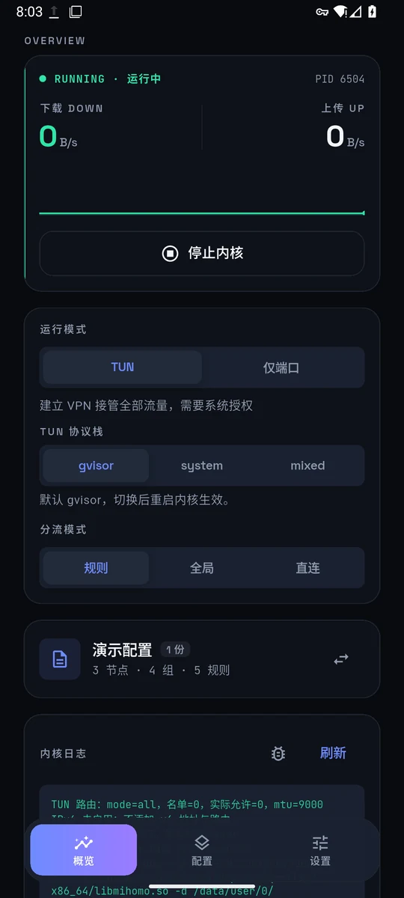</a> | <a href="docs/screenshots/proxies.webp">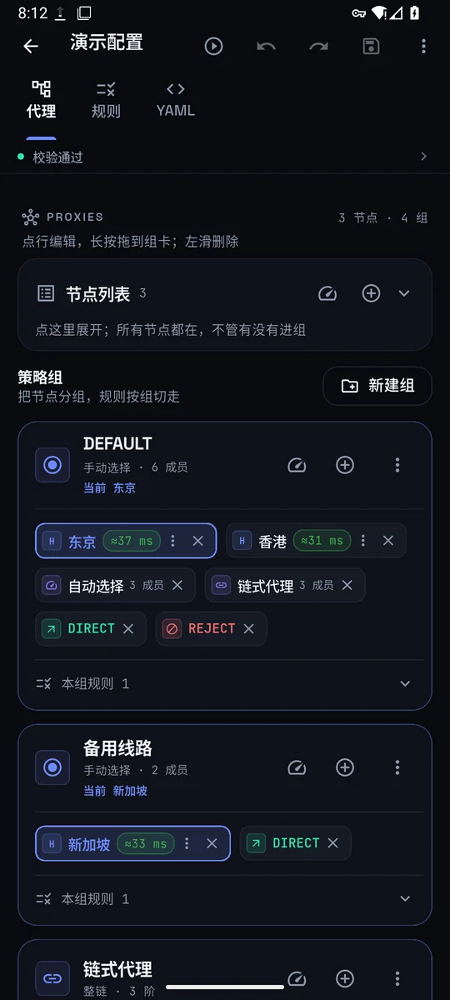</a> | <a href="docs/screenshots/rules.webp">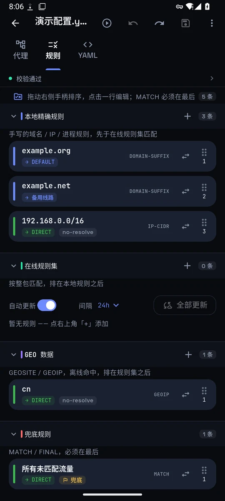</a> |
| 启停内核，查看流量与诊断。 | 编辑节点，管理手动选择、自动测速和链式策略组。 | 按分类管理规则，拖动右侧手柄排序。 |

## 安装与上手

1. 在 [最新正式版](https://github.com/yurin7/ClashDeck/releases/latest) 下载 APK。大多数手机选 **arm64-v8a**，x86 模拟器选 **x86_64**。支持 Android 7.0 及以上，APK 已包含 mihomo 和 GEO 数据。
2. 打开「配置 → 导入」，从文件选择 YAML，或粘贴 YAML、节点分享链接及订阅地址。也可以新建配置后手动添加节点。
3. 回到「概览」选择运行配置，点「启动内核」并确认系统 VPN 授权。TUN 支持 `gvisor`、`system` 和 `mixed`，还可按应用分流。使用本地代理端口时选择「仅端口」。
4. 已安装 ClashDeck 后，从「设置 → 检查更新」下载匹配的正式版，再在 Android 安装界面确认。同签名正式版覆盖安装会保留配置。

## 操作演示

以下操作均录自 Android 模拟器。点图片可以查看原尺寸。

| 内核运行时切换出口 | 拖动成员到另一个策略组 |
| :---: | :---: |
| <a href="docs/screenshots/selector.gif">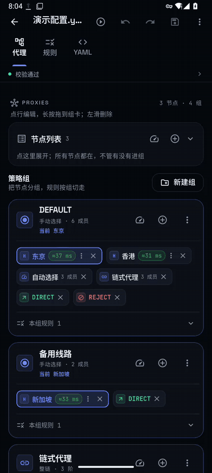</a> | <a href="docs/screenshots/group-drag.gif">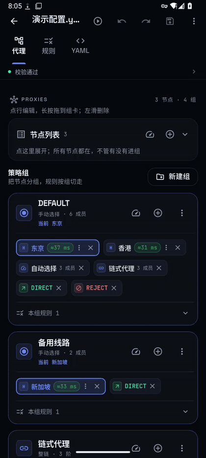</a> |
| 在当前运行配置的手动选择组里点按已有成员，出口立即切换。 | 长按节点拖到目标组。嵌套策略组可以拖入手动选择组。 |
| **调整链式顺序** | **更改规则出口** |
| <a href="docs/screenshots/relay.gif">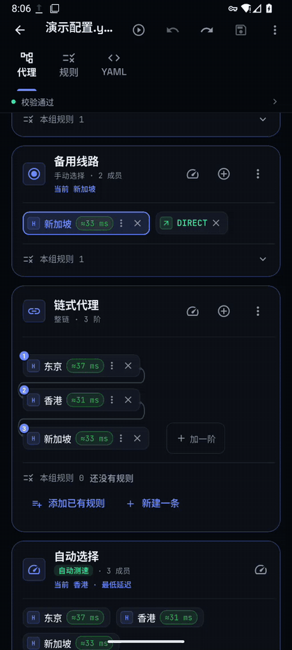</a> | <a href="docs/screenshots/rule-switch.gif">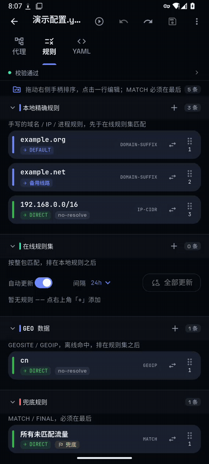</a> |
| 拖动链节，观察节点让位和虚线占位，松手后按新顺序连接。 | 点规则行尾的换组按钮，选择策略组或系统策略。 |

改动策略组成员或规则后，保存当前运行配置即可让内核应用新内容。

## 更多界面

| 配置管理 | 从文件导入 | 手动添加节点 |
| :---: | :---: | :---: |
| <a href="docs/screenshots/profiles.webp">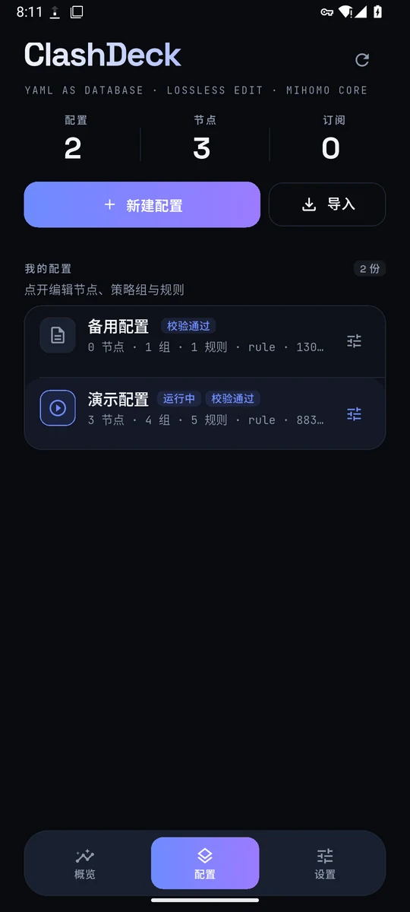</a> | <a href="docs/screenshots/import.webp">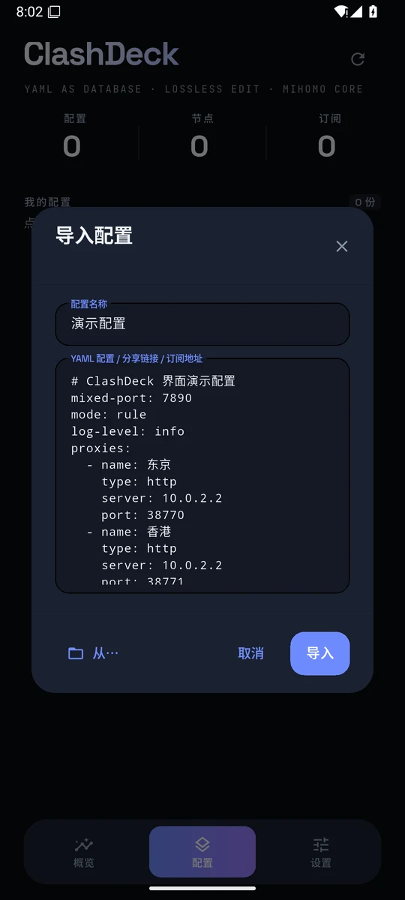</a> | <a href="docs/screenshots/node-form.webp">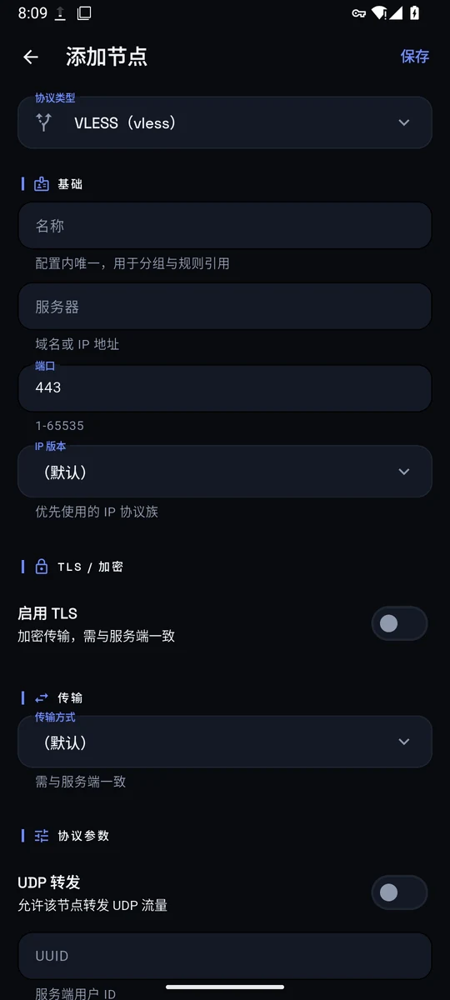</a> |
| **YAML 原文** | **Pulse 测速** | **应用内更新** |
| <a href="docs/screenshots/yaml.webp">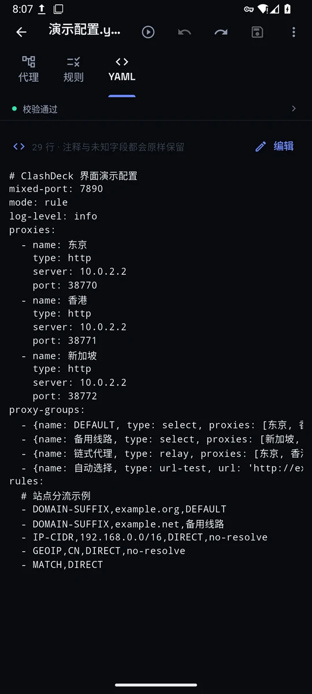</a> | <a href="docs/screenshots/pulse.webp">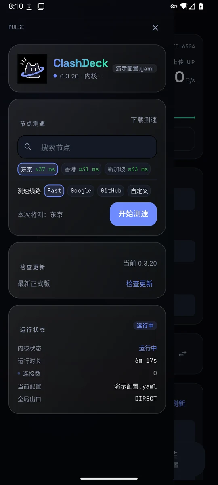</a> | <a href="docs/screenshots/update.webp">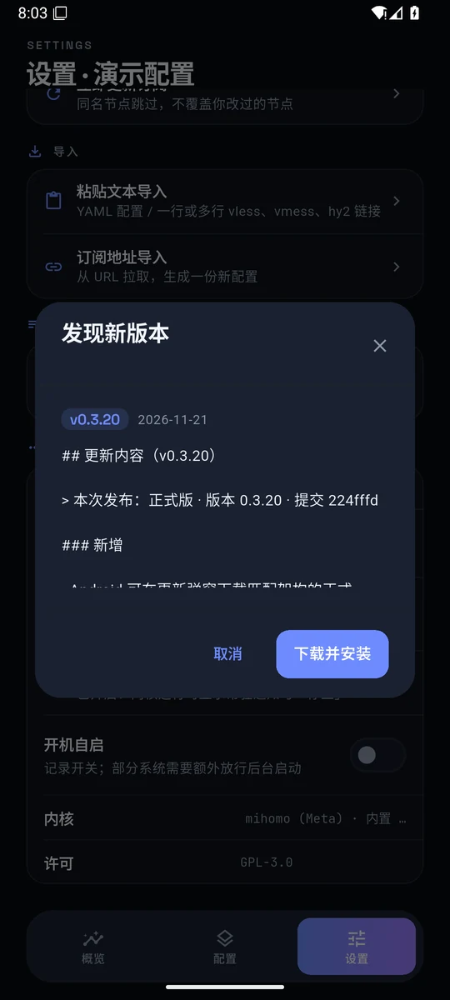</a> |
| **运行设置** | **在线规则集** | **GEO 条目** |
| <a href="docs/screenshots/settings.webp">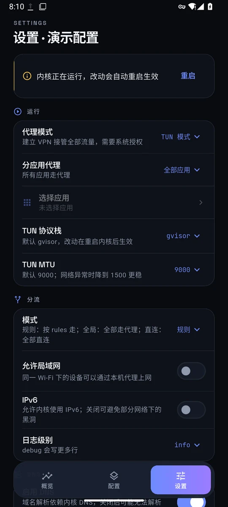</a> | <a href="docs/screenshots/online-rules.webp">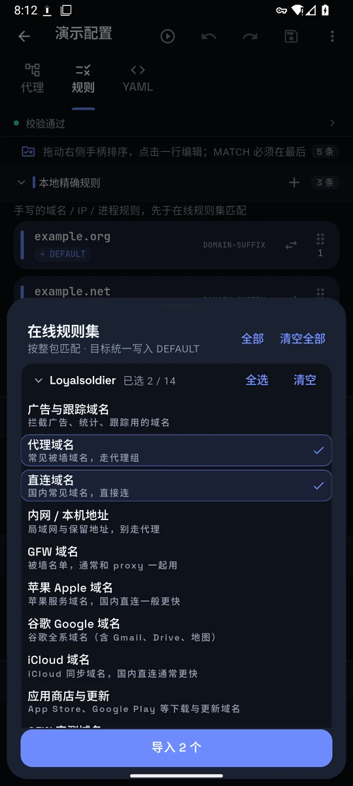</a> | <a href="docs/screenshots/geo-rules.webp">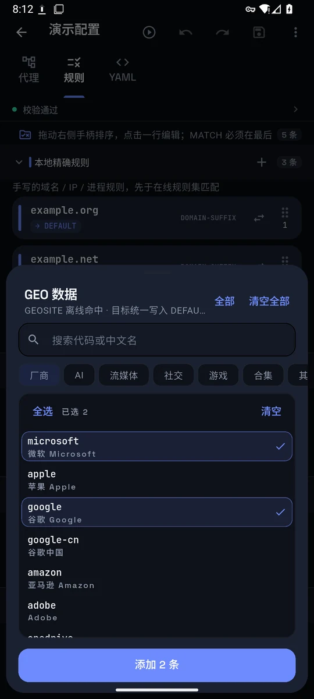</a> |

- **保留配置原文**。界面编辑只修改 YAML 中对应的片段，保留其他位置的注释、键顺序与扩展字段。YAML 页可以查看、复制或替换整份配置。
- **订阅和规则集**。可定时刷新订阅，使用 Loyalsoldier、ACL4SSR 预置或自定义在线规则集。GEOIP 和 GEOSITE 可搜索后批量添加。
- **随手查看与启停**。概览页向右滑打开 Pulse 测速，点 Pulse 上的应用图标或名称可访问项目主页。常驻通知、快捷设置磁贴和桌面小组件提供内核启停入口。

项目使用 [GPL-3.0](LICENSE)。内置内核、数据与其他第三方组件见 [第三方声明](NOTICE.md)。
